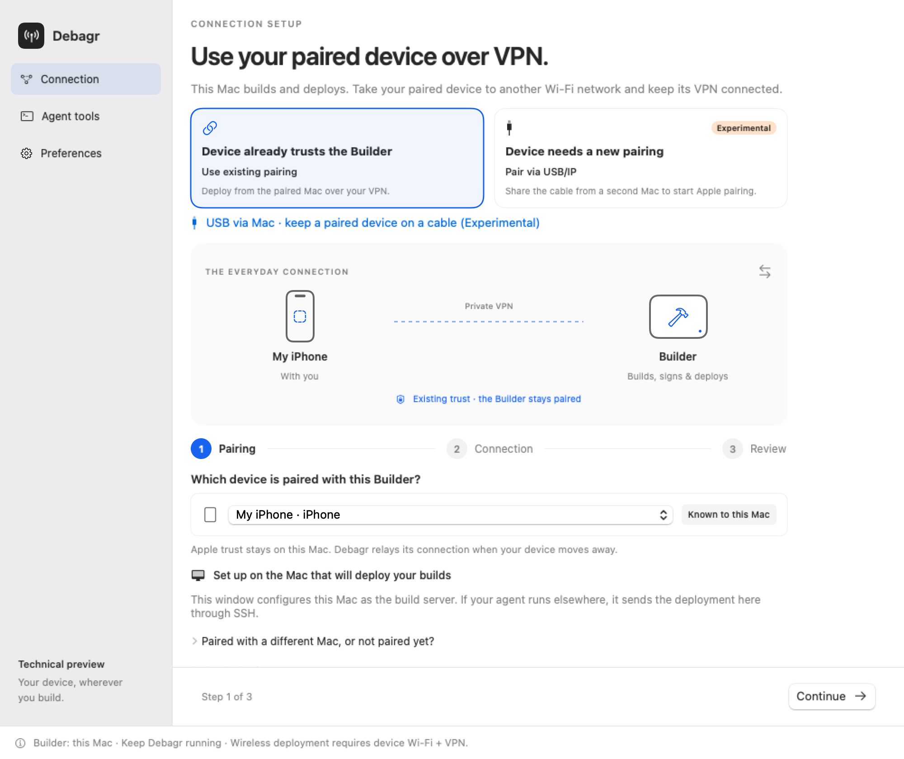
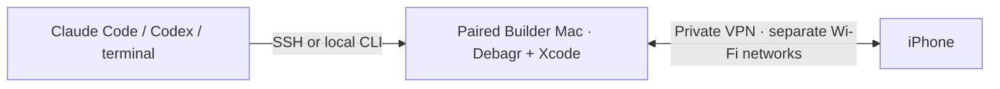

<p align="center">
  
</p>

<h1 align="center">Debagr</h1>

<p align="center"><strong>Your Mac stays home. Your next build comes with you.</strong></p>

<p align="center">Ask Claude Code, Codex, or your terminal to install and launch a signed iPhone build<br>through its paired Mac—even on another Wi-Fi network.</p>

<p align="center">
  <a href="docs/RELEASE.md"></a>
  <a href="docs/COMPATIBILITY.md"></a>
  <a href="docs/COMPATIBILITY.md"></a>
  <a href="#quick-start"></a>
  <a href="docs/EULA.md"></a>
</p>

<p align="center"><a href="#quick-start">Get started</a> · <a href="docs/PLUGINS.md">Agent plugins</a> · <a href="docs/COMPATIBILITY.md">Compatibility</a></p>

**Technical preview:** one managed remote device. One iPhone install and
OS-confirmed launch verified over Tailscale with a 0.3.0 candidate. Wi-Fi and a
private VPN required; cellular-only operation is unsupported.

<picture>
  <source media="(prefers-color-scheme: dark)" srcset="Marketing/screenshots/device-setup-dark.png">
  <source media="(prefers-color-scheme: light)" srcset="Marketing/screenshots/device-setup-light.png">
  
</picture>

*Connection screen in the 0.3.0 source preview, shown with sample device data.*

## From prompt to pocket

Install the [Claude Code or Codex plugin](docs/PLUGINS.md), then ask:

> Use Debagr on `build-server` to install and launch
> `/Users/me/Builds/MyApp.app` on my iPhone.

The agent checks readiness and invokes Debagr on the paired Mac. An illustrative
CLI call and successful result look like this (result fields excerpted):

```sh
debagr --deploy-app /Users/me/Builds/MyApp.app --device DEVICE_ID --launch --json
```

```json
{"installed": true, "launched": true}
```

Success also requires the expected bundle identifier. If the device needs
unlocking or its connection needs attention, the agent gets a recovery instruction.

## How it works



The paired Mac builds, signs, installs and launches. Apple pairing and signing
stay on that Mac. Your agent can run there or use your existing SSH access;
the phone does not become an Xcode destination on another Mac.

## Quick start

```sh
brew install --cask radeknovis/debagr/debagr
```

Homebrew installs the published **0.3.0 build 5** preview. The screenshots and
patched USB/IP setup shown here describe the newer source candidate.
[Distribution and updates](docs/DISTRIBUTION.md)

1. **Start on the paired Mac.** Use the Mac your device already trusts, with
   Xcode installed and Developer Mode enabled. If you need a new pairing,
   connect directly by USB and approve Trust, or see the
   [remote USB/IP option](docs/usbip.md) if the Builder is elsewhere.
2. **Save the connection.** Connect the Mac and device to your private VPN.
   While the device is nearby, choose **Open Debagr** → **Use existing pairing**.
   Select the paired device, its VPN address and its nearby service, confirm
   they identify the same device, then choose **Save and Check Connection**.
3. **Deploy from anywhere with Wi-Fi.** Leave Debagr running in the paired Mac's
   logged-in session. Install the [agent plugin](docs/PLUGINS.md), give your agent
   the Mac's SSH alias and signed device `.app` path, and ask it to deploy.
   Keep the device unlocked and connected to the VPN.

[Detailed setup instructions](docs/PLUGINS.md#set-up-the-paired-mac-and-device)
include the connection steps and agent configuration.

### What you need

- An Apple-silicon Mac running **macOS 26+** for managed remote deployment.
- Current Xcode and a signed **device** `.app` build.
- A device paired with that Mac over USB once, with Developer Mode enabled.
- A private VPN on both the Mac and device; **Tailscale** is the hardware-verified path.
- Wi-Fi and an unlocked device during deployment.
- Existing SSH access when your agent runs on another computer.

The preview is free for personal/internal evaluation, with no redistribution.
Read the [preview licence](docs/EULA.md).

## CLI and recovery

<details>
<summary>Deploy directly from your terminal</summary>

Run on the paired Mac, using the signed device .app's path on that Mac:

```sh
debagr --devices --json
debagr --status --device DEVICE_ID --timeout 30 --json
debagr --deploy-app /absolute/path/App.app --device DEVICE_ID --launch --json
```

Recheck readiness after a build or artifact transfer. Allow 180 seconds for
installation and launch. Success requires the expected bundle identifier,
`installed: true` and `launched: true`. Apple pairing and signing stay on the
paired Mac; devices do not become Xcode destinations on another Mac.

For recovery, `--installed-apps` lists installed apps after an uncertain
installation, `--launch-app` retries a launch without reinstalling, and
`--diagnose` reports individual checks. An optional
[local MCP interface](docs/MCP.md) exposes the same commands over stdio.

</details>

## Choose a pairing path

**Use existing pairing** for everyday deployment. Run Debagr on the Mac that
the device already trusts. Save the device’s wireless service while nearby,
then use that Mac to deploy while the device is on another Wi-Fi network
with its VPN connected.

**Pair via USB/IP** is an experimental option in the source candidate for a
device that has never trusted the Builder. Plug the unlocked device into a
nearby Mac, export its USB connection, and import it on the Builder over the
private VPN. Approve Apple’s Trust prompt if shown. Both Macs need compatible
USB tools and administrator approval. [USB/IP setup and requirements](docs/usbip.md)

In the cabled iPad test, the Mac mini installed and launched its signed app
with `pymobiledevice3`. Xcode listed the iPad only as restorable. First-time
Trust, native Debagr deployment and the subsequent unplugged VPN connection
remain unverified for this route.

### Keep an already paired device on a cable

For an already paired phone plugged into another Mac, use the experimental
[cable service bridge](docs/CABLE_SHARING.md) through `debagr --cable`.
It forwards device services over Tailscale, with SSH controlling the cable host.
It requires an explicit cable endpoint and RemotePairing port. The phone must
already be paired with this Builder.

Authenticated connectivity and signed app installation were verified on one
MacBook Pro cable host with phone Wi-Fi off. Launch, debugger attachment,
automatic discovery and reconnect remain unverified or unimplemented.

## Preview limits

<details>
<summary>Hardware evidence and remaining validation</summary>

One managed remote device is supported. Verified on hardware: one remote iPhone
installation and OS-confirmed launch over Tailscale on 10 November 2026 with a
0.3.0 candidate build. Local tests and a VPN connection alone do not establish
a working Apple deployment path.

Not yet verified for 0.3.0:

- first launch on a clean Mac, and first launch offline;
- independent wireless iPad deployment;
- recovery after restart, sleep and wake, a network change, revoked trust or
  denied Local Network permission;
- Headscale, ZeroTier, NetBird and WireGuard;
- macOS 13 to 15;
- the Homebrew upgrade from 0.2.0 to 0.3.0;
- cable bridge launch/debugger attachment and recovery.

</details>

## Learn more

- [Setup and agent plugins](docs/PLUGINS.md)
- [Compatibility and hardware evidence](docs/COMPATIBILITY.md)
- [VPN providers and network setup](docs/NETWORK_PROVIDERS.md)
- [Support and troubleshooting](docs/SUPPORT.md)
- [Development and packaging](docs/DEVELOPMENT.md)
