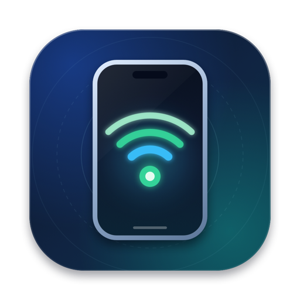

<p align="center">
  
</p>

<h1 align="center">Debagr</h1>

<p align="center">
  <strong>Your Builder Mac stays home. Your next build comes with you.</strong>
</p>

<p align="center">
  Native Apple silicon macOS menu-bar app, structured JSON CLI, and local stdio MCP server that let developers, CI jobs, and AI coding agents install and launch signed iOS &amp; iPadOS apps on a roaming physical device across separate Wi-Fi networks.
</p>

<p align="center">
  <a href="https://github.com/radeknovis/Debagr/actions/workflows/ci.yml"></a>
  <a href="https://github.com/radeknovis/Debagr/releases"></a>
  <a href="#quick-start"></a>
  <a href="#quick-start"></a>
  <a href="skills/debagr-deploy/SKILL.md"></a>
  <a href="https://github.com/radeknovis/homebrew-debagr"></a>
  <a href="site/legal.html"></a>
</p>

<p align="center">
  <a href="#quick-start">Quick Start</a> ·
  <a href="#core-premise--explicit-boundaries">Core Boundaries</a> ·
  <a href="#components">Components</a> ·
  <a href="#cli-reference--exit-codes">CLI &amp; Exit Codes</a> ·
  <a href="#documentation">Documentation</a>
</p>

<p align="center">
  
</p>

## Core Premise & Explicit Boundaries

- **Builder Mac keeps ownership:** Apple device pairing, trust records, Xcode, and code signing stay on your already-paired macOS **Builder**.
- **SSH stays your remote auth boundary:** Developers and coding agents reach the Builder locally or over SSH; Debagr never opens a custom network listener for deployment commands.
- **Private VPN wireless bridge:** Debagr captures your paired device's local wireless Bonjour identity once while nearby, probes `<vpn-ip>:<port>` over a private VPN (Tailscale, Headscale, ZeroTier, NetBird, or WireGuard), and registers a local `dns-sd` proxy so `xcrun devicectl` can verify readiness, install, and launch signed apps.
- **Explicit Out-of-Scope:**
  - Does **not** transfer Apple trust or turn a remote Mac into an Xcode pairing host.
  - Does **not** build or code-sign apps (callers provide a signed `iphoneos` `.app` bundle on the Builder).
  - Manages **one** remote physical iPhone or iPad at a time (Wi-Fi + private VPN required; cellular-only, simulators, and Mac app targets are out of scope).
  - **No** companion iOS app, **no** cloud backend, **no** user accounts, **no** analytics/telemetry, and **no** payment system.

## Components

| Component | Location | Purpose |
|---|---|---|
| Native Menu-Bar App & UI | `Sources/DebagrApp` | Background wireless bridge supervision, 4-step Wireless Setup wizard, live route topology, custom controls, redesigned Settings window, agent onboarding, experimental routes |
| Core & Wireless Bridge | `Sources/DebagrCore`, `Sources/DebagrBridge` | `0600`/`0700` local stores, dual-schema `devicectl` client, bundle signature/platform validation, `NWConnection` VPN probe, `dns-sd -P` proxy, sleep/wake & path recovery |
| Machine-Readable CLI | `Sources/DebagrCLI` | Same binary (`debagr`) outputs versioned JSON (`schemaVersion: "1.0"`) with recoverable exit codes |
| Local Stdio MCP Server | `Sources/DebagrMCP` | `debagr mcp` exposes 7 tools (`debagr_list_devices`, `debagr_check_readiness`, `debagr_diagnose`, `debagr_list_apps`, `debagr_install_app`, `debagr_launch_app`, `debagr_deploy_app`) |
| Shared Skill & Agent Plugins | `skills/debagr-deploy`, `plugins/` | Packaged Claude Code & Codex plugins teaching the safe `check -> build -> deploy -> recover` loop |
| Experimental Fallbacks | `Sources/DebagrExperimental` | Clearly labeled **Experimental** routes: *USB via Mac* (Cable Service Bridge) & *Pair via USB/IP* (Temporary Raw USB) |
| Static Website | `site/` | Zero-dependency landing page, setup guide, legal/privacy/evaluation license, and `site/config.js` |

## Quick Start

### 1. Install via Homebrew Cask (or Build from Source)

```bash
brew tap radeknovis/debagr
brew install --cask radeknovis/debagr/debagr
```

Or build from source on macOS 14+ (Apple silicon) with Xcode / `xcrun devicectl`:

```bash
swift build -Xswiftc -warnings-as-errors
swift test
./scripts/bundle-app.sh
```

### 2. Primary Workflow — Wireless Deployment ("Use Existing Pairing")
1. Ensure your iPhone/iPad is already paired via USB with the Builder Mac and Developer Mode is enabled.
2. Open `dist/Debagr.app` (or `/Applications/Debagr.app`) while the device is nearby on the same Wi-Fi.
3. Follow **Wireless Setup** to choose your device, select your private VPN (Tailscale/Headscale discovery or manual ZeroTier/NetBird/WireGuard private IP), capture its local `_apple-mobdev2._tcp` identity, and confirm physical hardware.
4. Once your phone moves to another Wi-Fi network over the VPN, run locally or over SSH:

```bash
debagr ready
debagr deploy --app /path/to/Build/Products/Debug-iphoneos/MyApp.app --terminate-existing
```

## CLI Reference & Exit Codes

```text
0  Success
1  General / install / verification / app bundle error
2  Invalid CLI usage or arguments
3  Device not configured, unreachable, unpaired, locked, or VPN unavailable
4  Partial success: app installed & verified, launch failed (use `debagr launch --bundle-id ...`)
5  Operation timed out with uncertain outcome (post-timeout app presence verified)
```

## Documentation

- [Architecture Overview](docs/architecture.md)
- [Security & Privacy Model](docs/security.md)
- [Experimental: USB via Mac (Cable Service Bridge)](docs/cable-bridge.md)
- [Experimental: Pair via USB/IP (Temporary Raw USB)](docs/usbip-pairing.md)
- [Shared Agent Skill](skills/debagr-deploy/SKILL.md)
