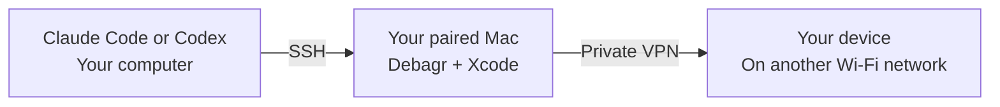

<p align="center">
  
</p>

<h1 align="center">Debagr</h1>

<p align="center">
  <strong>Your Mac stays home. Your next build comes with you.</strong>
</p>

<p align="center">
  Ask Claude Code or Codex to install and launch your signed app on your device.<br />
  Even when your device and its paired Mac are on separate Wi-Fi networks.
</p>

<p align="center">
  <a href="#get-started">Get started</a> ·
  <a href="docs/PLUGINS.md">Agent plugins</a> ·
  <a href="docs/DIRECT_DEVICE.md">Real-device evidence</a> ·
  <a href="#development">Build from source</a>
</p>

---

Leave your build Mac running at home or in the office. Take your device to
another Wi-Fi network, ask your coding agent for a deployment, and try the
latest build on the device in your hand.

Debagr is a native macOS menu-bar app that connects this workflow through
your private VPN. It runs on the Mac already paired with your device; your agent invokes
its CLI locally or through SSH. Your existing Xcode build and signing workflow
stays in place.

> **Technical preview.** Install and launch have been verified on an iPhone
> across separate Wi-Fi networks. Initial USB pairing and local configuration
> are required. Keep the paired Mac running with Debagr open, and the device on
> Wi-Fi with its VPN connected. Cellular-only operation is unsupported.

## How it works



The agent can run on a third computer, or directly on the paired Mac. The Mac
checks device readiness, installs your signed device `.app`, confirms its bundle
identifier, and launches it. Results include recovery instructions when a device
is locked or unavailable.

| Component | What it does |
| --- | --- |
| **Debagr app** | Device setup, connection management, readiness, and the last successful deployment |
| **Claude Code or Codex plugin** | Teaches your agent the deployment and recovery workflow |
| **CLI** | The same deployment commands for agents, scripts, and CI, with structured JSON results |

Apple pairing stays with its original Mac. Debagr deploys through that Mac;
remote devices do not become Xcode run destinations on the agent's computer.

## Network providers

| Provider | Device selection | Verification |
| --- | --- | --- |
| Tailscale | Automatic online-device list | Remote install and launch previously verified on hardware |
| Headscale | Automatic list through the Tailscale client connected to your server | Implemented; hardware validation pending |
| ZeroTier | Enter the device's private VPN IPv4 address | Implemented; hardware validation pending |
| NetBird | Enter the device's private VPN IPv4 address | Implemented; hardware validation pending |
| WireGuard | Enter the device's private tunnel IPv4 address | Implemented; hardware validation pending |

Install and connect your VPN on both devices first. Debagr uses that connection;
it does not create provider accounts or configure tunnels. See the
[provider setup guide](docs/NETWORK_PROVIDERS.md) for requirements and CLI examples.

## Get started

### 1. Set up your Mac and device once

Setup opens in a resizable Debagr window with a single form for network and device selection, inline
validation, and progress. Tailscale and Headscale device lists load automatically
when selected; other providers use an address field.

Build Debagr using the [source instructions below](#development), then install
`Debagr.app` in `/Applications` on the Mac that will deploy your builds. The
[release runbook](docs/RELEASE.md) covers Developer ID signing and notarization
for distribution.

Install Xcode, pair your device over USB, grant trust, and enable Developer Mode.
Connect the Mac and device through your chosen private VPN. While the device's Bonjour service is
available locally, open Debagr and choose **Set Up Remote Device…**. Select
your VPN provider, the Apple device, its Bonjour service, and the same device’s
VPN device or private IPv4 address, then
choose **Connect device**. **Agent tools** includes the plugin guides and a
copyable deployment prompt.

Leave Debagr open in that user's logged-in session. **Launch at Login** restores
the app after login. Your device can then move to another Wi-Fi network.

### 2. Install your agent plugin

Follow the [Claude Code or Codex installation guide](docs/PLUGINS.md) on the
computer running your agent. Both plugins share one deployment skill. Install
Debagr separately on the paired Mac.

For a standalone skill, **Show AI Deployment Skill…** reveals the copy bundled
with the app. Use either the plugin or the standalone skill in each client.

### 3. Ask for a deployment

Give your agent the Mac's SSH alias, intended device, and either the project's
build instructions or the path to an existing signed device `.app` on that Mac:

> Use Debagr on `build-server` to install and launch
> `/Users/me/Builds/MyApp.app` on my target device. The device is on another Wi-Fi network.

The agent checks readiness before deploying and confirms installation and
launch separately. A confirmed launch establishes that the app started;
checking its UI and behavior is a separate step.

## Requirements and current limits

| Target | Current scope |
| --- | --- |
| iPhone | Implemented; prior remote install-and-launch evidence over Tailscale |
| iPad | Implemented; full remote hardware acceptance remains pending |
| Mac | Possible future target; macOS app deployment is not implemented |

“Build Mac” means the computer running Debagr and Xcode. “Target device” means
the device receiving the app. The current pairing and deployment flow supports
iOS and iPadOS; a Mac target will need a separate deployment path.

- **An Apple-silicon Mac with macOS 26+, Xcode and Debagr running.** Remote callers need existing
  SSH access as the user who owns the pairing and runs Debagr.
- **A supported device on Wi-Fi, connected through a private VPN.** Complete initial pairing
  and local device configuration before taking it remote. Unlock it for deployment.
- **A signed device build on the paired Mac.** Use your project's existing build
  workflow; simulator builds cannot be installed on a device.
- **One managed remote device.** Ordinary local Apple-device deployment remains
  available. The full remote hardware acceptance matrix is still pending.

See [direct-device evidence](docs/DIRECT_DEVICE.md) for tested configurations
and [compatibility](docs/COMPATIBILITY.md) for supported and experimental scope.

## Deploy from the terminal

The CLI works locally on the paired Mac:

```sh
/Applications/Debagr.app/Contents/MacOS/Debagr \
  --deploy-app /absolute/path/MyApp.app \
  --device DEVICE_UDID \
  --launch --json
```

Or invoke the same command through the Mac's existing SSH access:

```sh
ssh build-server \
  "/Applications/Debagr.app/Contents/MacOS/Debagr \
  --deploy-app /absolute/path/MyApp.app --device DEVICE_UDID --launch --json"
```

The `.app` path is on the paired Mac. Quote paths as single arguments; when
using SSH, shell-quote each remote argument too. See the
[deployment workflow](docs/AI_DEPLOYMENT.md) for inventory, readiness, diagnostics,
JSON results, and failure recovery.

## Documentation

| Guide | What's inside |
| --- | --- |
| [Plugin onboarding](docs/PLUGINS.md) | Claude Code and Codex installation, first deployment, and package validation |
| [Deployment workflow](docs/AI_DEPLOYMENT.md) | Human setup, agent commands, and recovery |
| [Real-device evidence](docs/DIRECT_DEVICE.md) | Remote-network results and technical limits |
| [Architecture](docs/ARCHITECTURE.md) | How Debagr fits together |
| [Compatibility](docs/COMPATIBILITY.md) | Supported and experimental capabilities |
| [Release runbook](docs/RELEASE.md) | Signing, notarization, and clean-Mac acceptance |
| [Support](docs/SUPPORT.md) · [Security](docs/SECURITY.md) | Troubleshooting and security-policy drafts |
| [Privacy](docs/PRIVACY.md) · [Terms](docs/EULA.md) | Release-policy drafts awaiting owner and legal review |

## Development


The local menu-bar inventory supports macOS 13 or later. Remote deployment and
the experimental relay require macOS 26 or later for exact Network.framework
address binding. The preview package targets Apple silicon.

```sh
swift build
swift test
```

The executable is `.build/debug/debagr`.

### Package the app

```sh
./scripts/build-macos-app.sh release
./scripts/verify-macos-app.sh
open Debagr.app
```

The default build is ad-hoc signed for local testing. A customer release must
use a Developer ID Application identity and Apple's notarization service:

```sh
VERSION=1.0.0 \
BUILD_NUMBER=42 \
CODESIGN_IDENTITY="Developer ID Application: Example, Inc. (TEAMID)" \
NOTARY_PROFILE="debagr-notary" \
DEBAGR_WEBSITE_URL="https://example.com/debagr" \
DEBAGR_SUPPORT_URL="https://example.com/debagr/support" \
./scripts/release-macos-app.sh
```

That produces a notarized, stapled DMG and SHA-256 checksum in `dist/`. See
[`docs/RELEASE.md`](docs/RELEASE.md) for the account-bound setup and clean-Mac
acceptance checklist.

### Package the agent plugins

```sh
python3 scripts/package-plugins.py
```

This creates separate Claude Code and Codex ZIP packages and SHA-256 checksums
in `dist/`. Both include the canonical `Skills/debagr-deploy` directory and
onboarding instructions. Plugin versions live in `.claude-plugin/plugin.json`
and `.codex-plugin/plugin.json` and must match. Packaging verifies archive
contents and skill bytes. CI also produces the plugin archives.

See [plugin installation and validation](docs/PLUGINS.md) for local testing.

## Connection details

<details>
<summary>Menu-bar controls and diagnostics</summary>

Use **Connect/Disconnect Remote Device** to control the managed connection.
Existing private profiles can be imported. Configuration is stored privately at
`~/.config/debagr/managed-device.json` and excluded from public CLI results.
The app owns its relay; CLI invocations use that running connection.

The menu shows discovered devices and prerequisite checks, refreshes discovery,
and copies deployment commands or support reports. Support reports include
app/system status and endpoints, but exclude TXT records and RemotePairing
payloads. A visible Bonjour service alone does not establish deployment readiness.

</details>

<details>
<summary>Experimental cross-Mac relay lab</summary>


Select a Tailscale peer and known RemotePairing port explicitly:

```sh
debagr --peer paired-mac --remote-port 49640
```

On the Mac that can already see the Target Device locally, the peer-side lab
forwarder is:

```sh
debagr --forward-remote --peer developer-mac --remote-port 49152
```

If more than one Target Device is present, constrain the captured service:

```sh
debagr --forward-remote \
  --peer developer-mac \
  --bonjour-host My-Device.local \
  --remote-port 49152
```

Discover all physical iPhones and iPads known to `devicectl`, enriched with any
complete local Bonjour services:

```sh
debagr --discover --timeout 5
```

The peer-side command now writes the captured instance name and TXT metadata to
the selected profile. Copy that profile to the Developer Mac before starting
its relay so the local projection preserves the Apple service identity.

This proves the fixed RemotePairing control port can be projected through a
tailnet. It does **not** make the Target Device usable from a differently paired
Mac: Apple pairing state belongs to each Mac, and CoreDevice negotiates a
dynamic link-local IPv6 tunnel after the control connection. Tailscale's macOS
transport and Debagr's layer-4 relay do not route that endpoint.

Before any future end-to-end experiment, require an honest relay-off baseline:

```sh
./scripts/verify-remote-environment.sh paired-mac paired-mac-tailnet-name DEVICE_UDID
```

The check refuses to continue when the Developer Mac can already reach the
Target Device directly, which prevents a shared-LAN false positive.

</details>

<details>
<summary>Relay safety boundaries</summary>


- Tailscale is resolved only from fixed executable paths and a selected peer
  must be online.
- Tailscale profiles and the legacy relay lab restrict destinations to `100.64.0.0/10`.
  Alternative-provider profiles accept explicitly selected RFC1918 or CGNAT IPv4 addresses.
- Listeners bind to the selected local interface, not `0.0.0.0`.
- By default, only this Mac's local interface address and loopback are accepted.
  `--allow-lan` is an explicit opt-in.
- RemotePairing bytes remain opaque. Debagr does not authenticate, decrypt,
  inspect, or log the payload.
- Owned child processes receive argument arrays directly and are stopped by
  process identifier.

These controls do not replace the missing mutual Debagr authorization design.
Do not sell or publicly promise transparent cross-Mac Xcode access. Direct-device
deployment uses the original paired Build Server and relays its dynamic tunnel
ports; it does not transfer Apple pairing or route a different Mac's negotiated
link-local tunnel.

</details>

## Release status

Paid distribution remains gated on packaged install-and-launch tests through
SSH on clean Macs with current iPhone and iPad hardware. Acceptance includes
locked-device recovery, restart, sleep, network changes, revoked trust, and
clear failure reporting. Developer ID, notarization, storefront, domain, and
legal-owner setup remain release requirements.

The [shipping report](docs/SHIP_STATUS.md) records completed checks and remaining
release gates. The [launch kit](Marketing/README.md) includes native screenshots,
landscape and vertical promo videos, launch copy, and sponsorship drafts.
The [launch-site preview](Marketing/site/index.html) keeps download and funding
links in preparation until their destinations are verified. Earlier pricing
hypotheses in [launch research](docs/LAUNCH_RESEARCH.md) are not an announced price.

Debagr is not affiliated with or endorsed by Apple or Tailscale.
