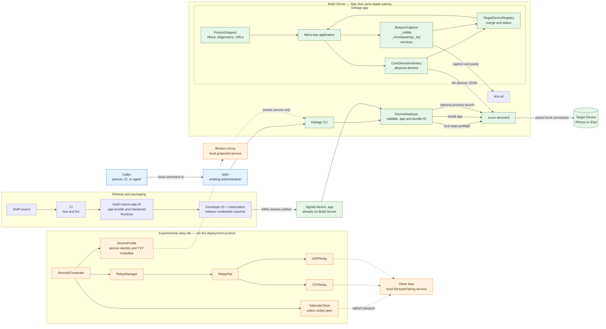

# Debagr architecture

Debagr has one supported product path—deployment executed on the Mac that owns
Apple pairing—and one experimental path—the layer-4 RemotePairing relay lab.
The relay does not transfer Apple pairing state or make a Target Device appear
in another Mac's Xcode.

## Supported deployment sequence

1. The Build Server is paired with the Target Device through Apple's normal
   Xcode/device workflow.
2. A Caller invokes the Debagr CLI locally or through SSH.
3. `DeviceDeployer` validates the signed `.app`, checks the device lock state,
   installs it with `xcrun devicectl`, and confirms the expected bundle ID.
4. With `--launch`, Debagr asks `devicectl` to launch that same bundle.

The menu-bar app is a monitor and command helper. Its Bonjour view indicates
visibility only; it is not proof that installation or launch will succeed.

## Relay-lab boundary

The relay lab forwards opaque TCP/UDP traffic toward a selected Tailscale peer
and can project a Bonjour control service. It does not authenticate Debagr
callers, inspect RemotePairing payloads, or reproduce Apple's negotiated
link-local tunnel and pairing state. It must not be presented as transparent
cross-Mac Xcode access.
