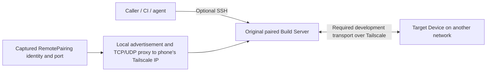
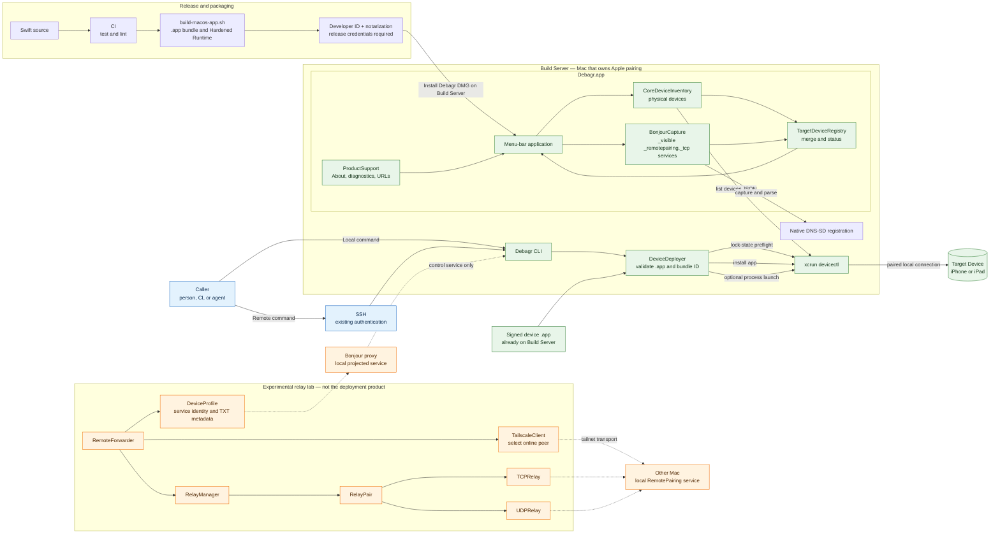

# Debagr architecture

Debagr must keep the original Build Server's Apple pairing usable when the
Target Device moves to another network. Wireless operation uses Tailscale on the Builder and phone. The cable route
uses Tailscale between the Macs and a USB network link to the phone. Remote invocation by a Caller alone does not satisfy this requirement.
The direct-device mode remains experimental; install and launch on a roaming
iPhone were verified on 10 October 2026. Reconnection and cellular operation
remain unverified. See [DIRECT_DEVICE.md](DIRECT_DEVICE.md) for test evidence.

The following component map includes the earlier two-Mac relay lab. It is
separate from the direct-device experiment and does not prove roaming support.

## Supported deployment sequence

1. The Build Server is paired with the Target Device through Apple's normal
   Xcode/device workflow.
2. A Caller invokes the Debagr CLI locally or through SSH.
3. `DeviceDeployer` validates the `.app` path and bundle ID, requests device lock state,
   installs it with `xcrun devicectl`, and confirms the expected bundle ID.
4. With `--launch`, Debagr asks `devicectl` to launch that same bundle.

The menu-bar app is a monitor and command helper. Its Bonjour view indicates
visibility only; it is not proof that installation or launch will succeed.
Apple performs signing validation. The Debagr DMG is distinct from the signed
iOS/iPadOS app being deployed.

## Relay-lab boundary

The relay lab forwards opaque TCP/UDP traffic toward a selected Tailscale peer
and can project a Bonjour control service. It does not authenticate Debagr
callers, inspect RemotePairing payloads, or reproduce Apple's negotiated
link-local tunnel and pairing state. It must not be presented as transparent
cross-Mac Xcode access.

## Restored connection interface

`DeviceSetupView` keeps one root window for wireless setup and the cable guide.
`DeviceSetupModel` preserves explicit identity confirmation, saved profiles,
asynchronous developer-tool checks and editable invalid addresses. The cable
bridge is started through its CLI; the guide does not create a pairing or start
sharing. UI models and menu actions remain main-actor owned.

`CableSharing` starts one SSH-owned host helper, and `CableHostControl` opens
upstream TCP/UDP listeners before `DirectDeviceApplication` opens its matching
local listeners. Saved tunnel ports are preopened to avoid Xcode's immediate
connection race. The existing watcher learns additional tunnel ports. The host
is restricted to one cable endpoint and one Builder VPN source address.

See [the connection design](CONNECTION_DESIGN.md) for the workflows and hardware
acceptance boundaries.
