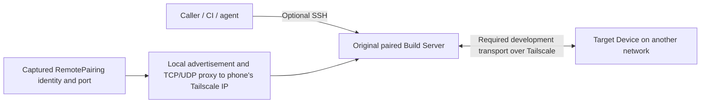
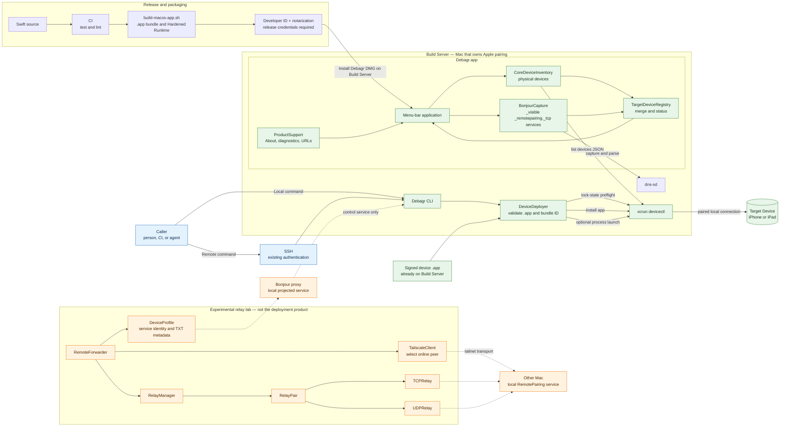

# Debagr architecture

Debagr must keep the original Build Server's Apple pairing usable when the
Target Device moves to another network. Tailscale runs directly on both
endpoints. Remote invocation by a Caller alone does not satisfy this requirement.
The direct-device mode remains experimental; install and launch on a roaming
iPhone were verified on 10 October 2026. Reconnection and cellular operation
remain unverified. See [DIRECT_DEVICE.md](DIRECT_DEVICE.md) for test evidence.



The following component map includes the earlier two-Mac relay lab. It is
separate from the direct-device experiment and does not prove roaming support.



## Supported deployment sequence

1. The Build Server is paired with the Target Device through Apple's normal
   Xcode/device workflow.
2. A Caller invokes the Debagr CLI locally or through SSH.
3. `DeviceDeployer` validates the `.app` path and bundle ID, requests device lock state,
   installs it with `xcrun devicectl`, and confirms the expected bundle ID.
4. With `--launch`, Debagr asks `devicectl` to launch that same bundle.

The menu-bar app is a monitor and command helper. Its Bonjour view indicates
visibility only; it is not proof that installation or launch will succeed.
Apple performs signing validation. The Debagr DMG is distinct from the signed
iOS/iPadOS app being deployed.

## Relay-lab boundary

The relay lab forwards opaque TCP/UDP traffic toward a selected Tailscale peer
and can project a Bonjour control service. It does not authenticate Debagr
callers, inspect RemotePairing payloads, or reproduce Apple's negotiated
link-local tunnel and pairing state. It must not be presented as transparent
cross-Mac Xcode access.

## Initial pairing and everyday wireless setup

`InitialPairingCoordinator` owns the initial Builder/Client diagram and
USB/IP controls. `DebagrPeerDiscovery` advertises read-only device names and
machine state; `RoleSyncService` uses signed challenges and pinned keys for role
updates. Verified personal Tailscale endpoints can bootstrap Mac trust without
a code; LAN connections require code confirmation. That Mac link never substitutes
for Apple's device trust or grants remote privileged transport control.

`USBIPSessionController` starts a local, transient root supervisor through macOS
approval. The Client exports via external Longcable; the Builder imports via
external usbip-macos after the bundled `USBIPProbe` succeeds. The SIP annotation
is informational. USB/IP sessions deliberately survive closing the app and have
explicit Stop controls. VirtualHere sessions instead end when their setup closes.
Neither backend is bundled, and Debagr never changes SIP.

On an idle Builder, the pairing window links to `DeviceSetupWindowController`
for everyday wireless configuration or the VirtualHere alternative. Navigation
prevents starting the other GUI backend while a setup session is active. Returning
to initial pairing retains Mac role selection and existing Apple trust. Wireless
readiness still comes from `ManagedDeviceRuntime`; the USB/IP Check Device action
does not establish which transport carried the successful CoreDevice request.

## VirtualHere alternative

`USBPairingModel` drives four native setup stages. Its serial worker owns a
`USBPairingSession`, a bounded command runner, and an SSH process tied to the app's
lifetime. VirtualHere supplies the USB virtualization; Debagr does not emulate a
USB controller or install drivers. The nearby Mac's server must listen only on
127.0.0.1:7575. Existing SSH authentication protects the transport, and a local
lease prevents two Debagr sessions from claiming devices concurrently.

```mermaid
sequenceDiagram
  participant UI as Build Mac / Debagr
  participant VH as Build Mac / VirtualHere Client
  participant Near as Nearby Mac / VirtualHere Server + Debagr
  participant Phone as iPhone
  UI->>Near: SSH preflight and loopback listener check
  UI->>VH: Add hub through owned SSH tunnel; list devices
  UI->>VH: Claim selected USB serial
  VH->>Near: USB traffic over SSH
  Near->>Phone: Physical USB cable
  UI->>Phone: devicectl pair; user approves Trust
  UI->>UI: Verify USB identity, Apple inventory, and lock state
  UI->>Near: Capture selected Bonjour profile over SSH
  UI->>VH: Release selected device; remove owned hub
  UI->>UI: Confirm USB disappearance; close SSH tunnel
  UI->>Phone: Managed runtime checks direct wireless connection
```

The private `--usb-services --json` helper returns a versioned list of service
names and hosts. `--usb-profile --json` returns the existing private `DeviceProfile`
payload, including service metadata. Neither transfers an Apple pairing record.
The helpers are invoked only through the user's existing SSH access; profile data
is kept out of application logs and public diagnostics. Apple trust is created by
`devicectl manage pair` on the build Mac, with consent entered on the phone.

USB acceptance, Apple pairing, wireless readiness, installation, and launch are
separate gates. Tests use a simulated backend; physical validation is still
required. See [connection design](CONNECTION_DESIGN.md) for prerequisites,
recovery behavior, and the hardware acceptance sequence.
