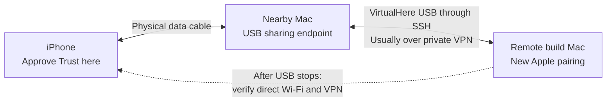

# Debagr connection design

Debagr connects the iPhone in your hand to the Mac that deploys your builds. Setup starts with one decision: reuse that Mac's existing Apple pairing, or create a new pairing through a USB bridge. The interface names the machine responsible for each step and keeps pairing, connectivity, installation, and launch separate.

The source build consolidates the published launch baseline, the Builder/Client USB/IP work, and the illustrated wireless/VirtualHere setup. Initial pairing uses `InitialPairingCoordinator.swift`; everyday wireless setup uses `DeviceSetupWindow.swift` and `ConnectionFlow.swift`. The VirtualHere alternative uses the `USBPairing*` files and `USBProfileTransfer.swift`. These additions are not in the published 0.2.0 release. See [consolidation provenance and validation](CONSOLIDATION.md).

## Roles

| Role | Responsibility |
| --- | --- |
| iPhone or iPad | Approves Apple trust, enables Developer Mode, receives the signed app |
| Builder (build Mac) | Owns the Apple pairing; runs Xcode, Debagr, readiness checks, installation, and launch |
| Client (nearby Mac) | Shares the physically attached device during initial setup; can capture its nearby wireless service |
| Coding agent or CI | Invokes deployment on the build Mac, optionally through existing SSH access |

The two-column diagram selects a Builder and Client and synchronizes their roles. That **Mac-to-Mac link is not Apple device pairing**. A device paired only with the Client still needs trust with the intended Builder. A Debagr connection profile contains service metadata; importing it does not import Apple trust. Wireless configuration and the VirtualHere alternative run on the Builder itself.

## One entry point, separate setup stages

**Set Up Remote Device…** opens initial pairing on a new setup or a Client; a configured Builder opens wireless configuration. The initial-pairing screen preserves clickable Builder/Client cards, device lists, automatic opposite-role selection, signed role synchronization, and the Builder's SIP annotation. Verified Tailscale mesh connections can link Macs without a code; LAN connections retain code confirmation and all saved peer keys remain pinned.

Use **Set up wireless deployment…** after stopping temporary USB. An already paired phone can take this route without running USB/IP. **Use VirtualHere instead…** opens the alternative backend. Switching methods is disabled during the USB/IP session, preparation, or administrator approval; an active VirtualHere session must be stopped before returning to USB/IP. The Client directs the user to continue wireless setup on the Builder.

| Path | Purpose | Requirements and evidence |
| --- | --- | --- |
| Existing Apple pairing | Everyday Wi-Fi + VPN deployment through the original Builder | Prior physical install/launch evidence; no second Mac needed for everyday use |
| USB/IP | Temporary initial-pairing or pairing-refresh setup using the two-Mac diagram | Separately installed Longcable and usbip-macos; admin approval and a successful Builder capability probe; current unentitled importer uses SIP off |
| VirtualHere + SSH | Alternative temporary USB setup with guided Apple pairing and profile handoff | Separately installed client and licensed loopback-only server, existing SSH access; automated tests only so far |

The USB/IP experiment refreshed an existing pairing and was followed by a successful unplugged relay deployment. It did not demonstrate first-ever Apple trust. Neither backend's final integrated UI has fresh physical acceptance. See [USB/IP setup](usbip.md) and [hardware evidence](DIRECT_DEVICE.md).

## Existing pairing

1. **Pairing:** select the physical device known to this build Mac. If missing, connect by USB, unlock, approve trust, enable Developer Mode, and refresh. The diagram explains why the original build Mac remains involved.
2. **Connection:** select the private network and the iPhone's VPN endpoint. Capture its nearby wireless service once, or import its saved Debagr profile. Returning to an existing configuration preserves its profile, including when the phone is already remote. Changing device, provider, or endpoint invalidates an imported profile.
3. **Review:** show build Mac, target, provider, device address, and service source together. **Save & check connection** persists the setup and runs the existing managed connection check.

The result stays in the setup window. A successful readiness check confirms trusted Apple connectivity and an unlocked device. It does not confirm installation or launch, and it may use an existing local connection. Validate roaming by deploying with the iPhone on another Wi-Fi network. Cellular-only deployment remains unsupported.

## New pairing through USB forwarding

The default initial-pairing screen uses USB/IP. Follow [its setup guide](usbip.md) for the Client export, Builder import, Apple Trust prompt, read-only **Check Device**, and explicit Stop controls. To use the alternative described below, choose **Use VirtualHere instead…** on the Builder.

The network carries USB between the Macs; the iPhone still needs a physical data cable to the nearby Mac. Run setup on the **build Mac**.

### One-time prerequisites

1. On the build Mac, install this Debagr build and Xcode. Install [VirtualHere Client](https://www.virtualhere.com/usb_client_software) as `/Applications/VirtualHereUniversal.app`, open it, and finish its driver setup. Disable Auto-Use, including any existing rule for the target device. Debagr checks that Auto-Use All is off and claims only the selected device.
2. On the nearby Mac, install this same Debagr build as `/Applications/Debagr.app`. Install [VirtualHere Server for macOS](https://www.virtualhere.com/osx_server_software). Stop the server, set `NetworkInterface=127.0.0.1` in its `config.ini`, keep the default port `7575`, and restart it. **This interface setting requires a purchased VirtualHere server license**, as documented in its [configuration guide](https://www.virtualhere.com/configuration_faq). Debagr refuses a server listening on a LAN or wildcard interface.
3. Enable Remote Login on the nearby Mac. From the build Mac, establish and verify key-based SSH access to that Mac using its alias or `user@host`. Debagr uses strict host-key checking and batch authentication; it cannot answer password or unknown-host prompts. An existing SSH agent can authenticate locally; agent forwarding is disabled.
4. Connect both Macs through your private network. Put the iPhone and nearby Mac on the same Wi-Fi for wireless service capture. Connect the iPhone and build Mac to the selected VPN. Grant local-network access to Debagr when macOS asks. Plug the unlocked phone into the nearby Mac using a data cable.

Debagr does not install VirtualHere, approve drivers, buy a license, configure SSH, or create VPN accounts. With prerequisites complete, the native flow is:

| Step | Where to act | Required evidence before advancing |
| --- | --- | --- |
| Nearby Mac | Build Mac | Enter its SSH alias. Debagr checks the client, server binding, SSH access, and nearby Debagr, then opens a loopback SSH tunnel |
| Forward USB | Build Mac | Select the phone by name and serial suffix. Only devices from that tunnel are listed; an in-use device cannot be claimed |
| Approve trust | iPhone and build Mac | Start pairing. The selected serial must exist in the build Mac's USB registry. Approve Apple's request on the phone; Debagr confirms the matching Apple identity and unlocked connectivity |
| Go wireless | Build Mac | Select the same phone's service and VPN address. Debagr captures its profile over SSH, releases USB, confirms the USB serial is gone locally, closes its tunnel, saves configuration, then runs the managed wireless readiness check |

The nearby Mac captures Bonjour metadata because the build Mac may be on another network. Service names and VPN addresses cannot be automatically tied to a USB serial by the current capture API, so the user must explicitly confirm they describe the same iPhone. Missing metadata keeps USB connected. USB pairing alone never marks the wireless connection ready.

If wireless verification fails after handoff, the saved connection stays editable with the runtime's recovery instruction. USB remains stopped and the Apple pairing is retained. Enable Developer Mode before handoff; if its restart interrupts USB, stop and reconnect the session. Apple may require another trust prompt. There is no passcode entry field in Debagr.

### Session ownership and recovery

- The tunnel binds an allocated port on `127.0.0.1` to the nearby server's `127.0.0.1:7575`. VirtualHere API calls target only that hub and selected device; Debagr never uses global stop commands. Before releasing USB, it rechecks server identity, device serial, and the owning client UUID.
- Stop, closing setup, changing pairing path, and app termination cancel pending work and attempt device release and hub removal. SSH closes even if the client stops responding. Late results cannot reopen the workflow.
- Failed pairing or profile capture leaves the session available for retry. Delayed USB removal, failed hub removal, and failed configuration writes can be retried without repeating Apple trust.
- If cleanup cannot be confirmed, remove the unused `127.0.0.1` hub in VirtualHere before retrying. Forced app termination can leave a saved manual hub there; the SSH tunnel is tied to the app's input pipe and does not provide a persistent forwarding service. Debagr does not resume USB sessions after restart.
- This USB virtualization path is separate from the RemotePairing TCP/UDP relay. Forwarded USB does not establish that the subsequent wireless transport will work.

The backend follows the [VirtualHere client API](https://www.virtualhere.com/client_api). Its macOS server lists iPhone sharing, but vendor support does not establish a tested Debagr integration. [Apple's trust documentation](https://support.apple.com/en-us/109054) describes the approval step on the device.

## Status and recovery

| State | Meaning and next action |
| --- | --- |
| No known device | Connect the iPhone to the build Mac once, or use the new USB pairing workflow |
| No VPN endpoint | Connect the iPhone and build Mac to the private VPN, then refresh |
| No wireless service | Capture while nearby or import a matching saved profile |
| Setup saved | Configuration is stored; readiness is still being checked |
| Needs attention | Show the managed runtime's recovery instruction; keep editing and retry available |
| Ready for deployment | Trusted connectivity and lock-state check passed; offer agent tools |
| Installed | Confirmed by a deployment result, never by setup alone |
| Launched | Confirmed after installation; UI behavior still requires its own check |

The fixed action bar keeps one primary next step visible. The diagram is a topology explanation, not a live status display. Text and accessible labels carry meaning independently of color; custom device drawings have a complete VoiceOver description. Steps scroll within a resizable macOS window, with native controls and semantic colors for light and dark appearance.

## Validation

Automated coverage checks both native workflows, profile preservation, stale readiness results, scoped USB inventory, client ownership, SSH argument quoting, loopback-only listeners, USB identity, locked devices, partial command failures, cancellation, delayed removal, and cleanup/save retries. Backend tests use command fixtures; native render captures use example state.

Before claiming hardware support, complete this sequence on supported Macs and record exact OS, Xcode, VirtualHere, and iOS versions:

1. Start with a phone that has never trusted the build Mac. Complete the forwarded USB flow and approve trust on the phone. Confirm the matching USB serial, Apple UDID, and lock-state access.
2. Capture the phone's wireless profile, finish handoff, and confirm the device is absent from the build Mac's USB registry with no owned SSH tunnel remaining.
3. Disconnect the cable and move the phone to another Wi-Fi network. Require managed readiness, a real signed-app deployment with `installed: true`, and `launched: true`.
4. Exercise Trust cancellation, Developer Mode restart, device disconnect, locked phone, SSH loss, unavailable VirtualHere, app quit/relaunch, and profile-capture failure. Confirm no other client's devices are released.

Neither automated tests nor native screenshots establish this hardware acceptance. Cellular-only deployment remains unsupported.

## Menu bar

The menu leads with the configured target and current state, followed by native
Open Debagr, Debagr Skill, and Pause/Resume actions. The summary
shows a concrete recovery instruction and scopes the last deployment receipt to
the selected device. Client role and temporary USB activity never imply wireless
readiness. A matching successful Apple connectivity check is the readiness gate.

Device inventory and per-device commands remain under Devices. Agent Tools is a
top-level action; diagnostics use a secondary submenu. Launch at Login is a
direct toggle in the main menu alongside About Debagr. Native menu
rows retain keyboard navigation. `MenuConnectionPresentation` maps runtime evidence
to copy independently from `MenuConnectionSummaryView`; the menu updates cached
status without starting a blocking readiness check while it opens.

The redesigned menu is covered by presentation, action-placement, keyboard shortcut,
privacy and native layout checks. The original redesign had automated presentation and packaged CLI checks.
Current restoration checks and remaining acceptance gaps are recorded in
[the integration record](CONSOLIDATION.md).

Agent tools provides the shared Debagr skill and client installation links.
Generated deployment prompts and per-device command copying have been removed;
the skill chooses the appropriate CLI operations from the user's request.
